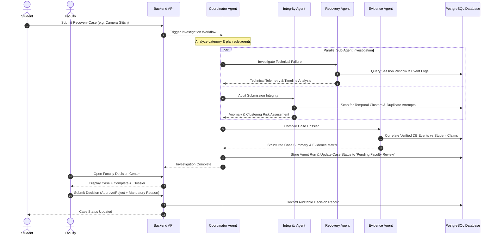

# CampusFlow — Agentic AI Attendance Trust & Recovery Platform

> **"Fair Attendance. Fewer Disputes. Less Manual Work."**

CampusFlow is an academic SaaS platform designed to solve attendance integrity and attendance recovery in higher education. Combining an independent QR attendance system with specialized Agentic AI investigation workflows, CampusFlow minimizes manual exception handling while guaranteeing students a transparent, auditable, and human-in-the-loop review process.

---

## ⚠️ Operational Boundary & System Disclaimer

1. **Independent System**: CampusFlow is an independent demonstration and operational decision-support platform. It does not integrate with, claim integration with, access, reverse-engineer, or store credentials for NIAT's internal attendance databases, QR services, or private APIs.
2. **Independent QR Attendance Engine**: CampusFlow generates and validates its own cryptographic QR attendance tokens exclusively for its own registered classes and sessions.
3. **Unverified External Reports**: When a student reports an attendance failure from an external college system, the case is explicitly marked and treated as an **Unverified External Report** until an authorized faculty member investigates and renders a human decision.
4. **Human-in-the-Loop Authority**: AI agents never mark attendance, alter records, or approve/reject recovery requests autonomously. All final decisions require an authenticated faculty member with a mandatory recorded justification.

---

## Architecture Overview

CampusFlow is architected as a modern, decoupled academic SaaS solution:

```mermaid
graph TD
    subgraph Client ["Frontend (React 18 + Vite + Tailwind CSS)"]
        UI_Student[Student Recovery & QR Scan Portal]
        UI_Faculty[Faculty Decision Center & QR Generator]
        UI_Admin[Institution Command Center]
    end

    subgraph Backend ["Backend API (Node.js + Express.js)"]
        API_Gateway[Express REST API /api/v1]
        Auth_MW[JWT & RBAC Middleware]
        QR_Engine[Cryptographic QR Engine (SHA-256)]
        
        subgraph MultiAgentEngine ["Multi-Agent AI Investigation Engine"]
            Coord[Coordinator Agent]
            Integ[Integrity Agent]
            Recov[Recovery Agent]
            Evid[Evidence Agent]
        end
    end

    subgraph Database ["Data & External Services"]
        PG[(PostgreSQL + Supabase with RLS)]
        Gemini[Google Gemini 2.0 Flash / Pro]
    end

    UI_Student -->|REST / JWT| API_Gateway
    UI_Faculty -->|REST / JWT| API_Gateway
    UI_Admin -->|REST / JWT| API_Gateway
    API_Gateway --> Auth_MW
    Auth_MW --> QR_Engine
    Auth_MW --> MultiAgentEngine
    MultiAgentEngine --> Gemini
    API_Gateway --> PG
```

### Core System Components

- **Frontend (`/frontend`)**: React 18, Vite, React Router 6, Tailwind CSS, Lucide React, Recharts (analytics), and `html5-qrcode` + `qrcode.react`.
- **Backend API (`/backend`)**: Express.js REST API with Helmet security headers, strict CORS, express-rate-limit, Zod schema validation, and Winston/Morgan logging.
- **Database (`/supabase`)**: PostgreSQL relational schema (14 tables) with Row-Level Security (RLS) policies, multi-tenant isolation (`institution_id`), and comprehensive composite indexes.
- **Agentic AI Orchestrator**: Multi-agent system utilizing Google Gemini (`@google/genai`) with structured JSON schema enforcement, prompt injection sanitization, timeout bounding, and deterministic heuristic fallbacks.

---

## Specialized Multi-Agent AI System

CampusFlow deploys four purpose-built AI agents to automate technical investigations and synthesize evidence for faculty:



1. **Coordinator Agent (`coordinatorAgent.js`)**:
   - Manages bounded orchestration workflows with hard step limits and execution timeouts.
   - Evaluates incoming case category and dispatches relevant sub-agents.
   - Reconciles conflicting findings and ensures cases are routed to the faculty review queue.
2. **Integrity Agent (`integrityAgent.js`)**:
   - Analyzes temporal patterns, submission velocity, and potential proxy attendance.
   - Computes statistical submission clustering (e.g., 8 submissions within a 2-second burst).
   - Evaluates risk objectively (*Low*, *Medium*, *High*, *Unknown*) without leveling disciplinary accusations.
3. **Recovery Agent (`recoveryAgent.js`)**:
   - Analyzes technical failure claims (QR camera failure, network timeout, session expiration).
   - Checks whether the session was active at the reported timestamp.
   - Correlates concurrent student scan telemetry to confirm or refute systemic outages.
4. **Evidence Agent (`evidenceAgent.js`)**:
   - Builds a chronological timeline of verified server facts versus unverified student statements.
   - Catalogs missing evidence (e.g., absent network error logs or mismatched class sections).
   - Generates an executive case dossier for faculty review.

---

## Role-Based Access Control (RBAC)

CampusFlow enforces strict role separation across three primary user types:

| Role | Access & Capabilities |
| :--- | :--- |
| **Student** | Scan CampusFlow QR codes; view personal attendance records; submit attendance recovery cases; provide additional requested information; track case statuses. |
| **Faculty** | Create classes; launch dynamic QR attendance sessions; inspect live session rosters; access the Faculty Decision Center; review AI investigation dossiers; render binding human decisions with mandatory recorded justifications. |
| **Administrator** | Manage institutional profiles, departments, subjects, and enrollments; monitor campus-wide attendance exception trends; audit agent run logs; enforce institutional compliance policies. |

> **Security Note**: Public registration is strictly restricted to the `student` role. Privileged `faculty` and `admin` roles can only be provisioned by institutional administrators or via seeded system migrations.

---

## Database Architecture & Row-Level Security

The platform relies on 14 PostgreSQL tables defined in `supabase/migrations/001_initial_schema.sql`:

1. `institutions` — Multi-tenant tenant boundaries.
2. `departments` — Academic departments within institutions.
3. `profiles` — User profile metadata linked to Supabase Auth UUIDs.
4. `classes` — Academic cohorts and course sections.
5. `subjects` — Subject catalog mapped to classes and faculty.
6. `enrollments` — Student enrollment records with status flags.
7. `attendance_sessions` — Dynamic QR sessions with hashed tokens, expiration timestamps, and geographic/network constraints.
8. `attendance_events` — Immutable audit log of every scan attempt (success, expired, duplicate, invalid hash).
9. `attendance_records` — Canonical attendance records created upon verified check-in or approved faculty recovery.
10. `recovery_cases` — Student exception and dispute tickets.
11. `case_evidence` — Supporting artifacts and technical telemetry.
12. `case_messages` — Communication threads between students and faculty.
13. `decisions` — Immutable faculty decisions with mandatory justifications.
14. `agent_runs` — Full audit trail of AI agent inputs, outputs, tokens, and run metrics.

All tables enforce **Row-Level Security (RLS)** ensuring students only query their own records, faculty access only their assigned classes and cases, and administrators maintain institution-scoped governance.

---

## Demo Credentials & Quick Switcher

For evaluation, testing, and demonstrations, CampusFlow includes pre-seeded demo accounts and a built-in **Demo Role Switcher** in the top navigation bar:

| Role | Name | Email | Password | Pre-loaded Context |
| :--- | :--- | :--- | :--- | :--- |
| **Student** | Alex Rivera | `alex.rivera@apex.edu` | `DemoStudent123!` | Enrolled in CS-301 & CS-302; sample submitted case with AI dossier. |
| **Faculty** | Prof. Marcus Vance | `prof.vance@apex.edu` | `DemoFaculty123!` | Teaches CS-301 (Algorithms); has pending recovery cases in decision queue. |
| **Admin** | Dr. Sarah Jenkins | `admin.jenkins@apex.edu` | `DemoAdmin123!` | Institutional Dean; full access to analytics, audit logs, and user rosters. |

---

## Local Development Quickstart

### Prerequisites

- Node.js 18.0.0 or higher
- npm 9.0+ or Yarn
- (Optional) Google Gemini API Key (`GEMINI_API_KEY`) for live generative AI synthesis. (If omitted, resilient built-in deterministic agent fallbacks will automatically activate).

### 1. Repository Setup

```bash
git clone https://github.com/your-org/campusflow.git
cd CampusFlow
```

### 2. Backend Setup

```bash
cd backend

# Copy environment configuration
cp .env.example .env

# Install dependencies
npm install

# (Optional) Run database migration & seed if DATABASE_URL is configured
npm run migrate
npm run seed

# Run automated test suite
npm test

# Start the Express API server (runs on http://localhost:5000)
npm run dev
```

### 3. Frontend Setup

```bash
cd ../frontend

# Copy environment configuration
cp .env.example .env

# Install dependencies
npm install

# Start Vite development server (runs on http://localhost:5173)
npm run dev
```

Visit `http://localhost:5173` in your browser. Use the **Demo Role Switcher** in the navbar to test Student, Faculty, and Admin personas with zero setup.

---

## API Documentation Reference

All endpoints are versioned under `/api/v1` and return standardized JSON response envelopes:

```json
{
  "success": true,
  "data": { ... },
  "message": "Operation completed successfully"
}
```

Detailed endpoint documentation, request/response schemas, and error codes are maintained in [`docs/API.md`](./docs/API.md).

---

## Production Deployment

### Frontend (Vercel)

The frontend is optimized for static deployment on Vercel:
1. Connect repository to Vercel.
2. Set Root Directory to `frontend`.
3. Build command: `npm run build`.
4. Output directory: `dist`.
5. The included `frontend/vercel.json` ensures all client routes rewrite correctly to `/index.html`.
6. Configure environment variable: `VITE_API_URL=https://your-backend-api.onrender.com/api/v1`.

### Backend (Render)

The backend includes a turnkey [`render.yaml`](./render.yaml) specification:
1. Create a new Web Service on Render linked to this repository.
2. Root Directory: `backend`.
3. Build command: `npm install`.
4. Start command: `npm start`.
5. Environment Variables:
   - `NODE_ENV`: `production`
   - `PORT`: `5000`
   - `CORS_ORIGIN`: `https://your-campusflow-frontend.vercel.app`
   - `DATABASE_URL`: Your Supabase connection string.
   - `SUPABASE_URL`: Your Supabase project URL.
   - `SUPABASE_SERVICE_ROLE_KEY`: Your Supabase service role secret.
   - `GEMINI_API_KEY`: Google Gemini API Key.
   - `QR_SECRET_KEY`: High-entropy random hex string.

---

## Future Integration Interfaces

CampusFlow is designed with clean abstraction layers to support official college integrations once institutional authorization and data-sharing agreements are in place:

- **LTI 1.3 Advantage**: Canvas, Blackboard, and Moodle gradebook and attendance synchronization.
- **Webhook Ingestion**: Authorized college single sign-on (SSO) event hooks (SAML 2.0 / OIDC).
- **Scheduled Synchronization Jobs**: Background reconciliation of external attendance archives.

---

## License & Intellectual Property

CampusFlow is an academic trust platform. Built with security, transparency, and human accountability at its core.

